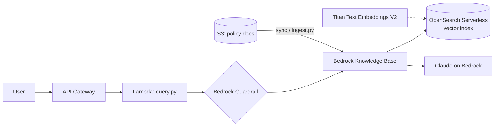

# 01 · Enterprise Knowledge Assistant (RAG)

**Live demo:** https://chidiebereian.github.io/capstone-projects-/#/rag

Employees ask questions about internal policy and get grounded answers with citations. If the knowledge base does not cover the question, the assistant declines instead of guessing.

## Architecture



## How it works
1. **Ingest.** Policy documents land in S3. `ingest.py` starts a Knowledge Base ingestion job that chunks, embeds (Titan Text Embeddings V2) and indexes them.
2. **Retrieve.** `query.py` calls `retrieve` to get the top-k chunks and their relevance scores.
3. **Ground check.** If no chunk scores above a threshold, return an "I don't know" answer. The browser demo does the same with question coverage.
4. **Generate.** `retrieve_and_generate` produces the answer with citations, with a guardrail applied to input and output.

## Run it
```bash
pip install -r requirements.txt
export KB_ID=xxxx DATA_SOURCE_ID=yyyy MODEL_ARN=arn:aws:bedrock:us-east-1::foundation-model/anthropic.claude-3-5-haiku-20241022-v1:0
python src/ingest.py
python src/query.py "How much can I spend on a client dinner?"
```

**Builds on labs** 09, 10, 11, 12, 13.
