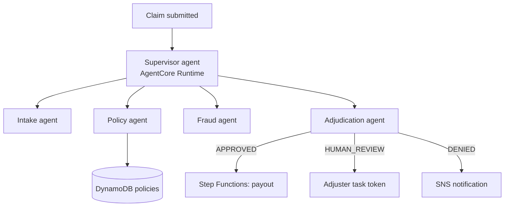

# 02 · Multi-Agent Insurance Claims Platform

**Live demo:** https://chidiebereian.github.io/capstone-projects-/#/claims

A supervisor agent coordinates four specialists (intake, policy verification, fraud scoring and adjudication). Clean claims are processed straight through; risky claims go to a human adjuster with an explainable fraud score.

## Architecture



- `src/agents.py` defines the specialists as **Strands agents exposed as tools** to a supervisor (the agents-as-tools pattern), served from the **AgentCore Runtime**.
- `statemachine/claims.asl.json` is the deterministic Step Functions backbone for payouts and human review. It uses `.waitForTaskToken`, so the workflow pauses until an adjuster decides.

## Run locally
```bash
pip install -r requirements.txt
python src/agents.py   # starts the AgentCore app on :8080
curl -X POST localhost:8080/invocations -d '{"prompt": "Claim POL-1001, Ada Okafor, auto, $3,200, rear-ended, police report attached"}'
```

**Builds on labs** 14, 15, 16, 17, 18.
