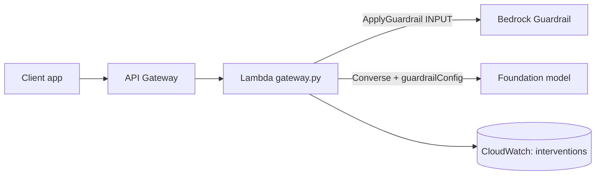

# 03 · Responsible AI Guardrails Gateway

**Live demo:** https://chidiebereian.github.io/capstone-projects-/#/guardrails

A Lambda gateway that sits in front of every model call. It masks PII, blocks denied topics and prompt attacks, and logs every intervention, using Amazon Bedrock Guardrails.

- `src/create_guardrail.py` creates the guardrail: content filters including PROMPT_ATTACK, denied topics, a custom word list and PII masking or blocking.
- `src/gateway.py` checks input with `apply_guardrail`, then calls `converse` with `guardrailConfig` so the output is checked too.

**Builds on labs** 06, 07, 08, 09.
