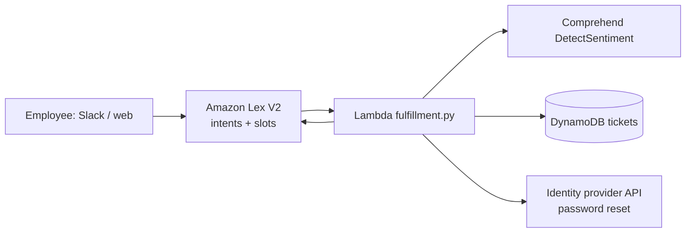

# 05 · AI-Powered IT Help Desk

**Live demo:** https://chidiebereian.github.io/capstone-projects-/#/helpdesk

A Lex V2 bot handles common IT requests. A Lambda fulfillment hook scores sentiment with Comprehend, sets ticket priority, auto-resolves password resets and writes tickets to DynamoDB.

| Intent | Slots | Fulfilment |
|---|---|---|
| ResetPassword | system | Auto-resolved via IdP API |
| VpnIssue | location, os | Ticket to Network |
| HardwareFailure | device, urgency | Ticket to Field Services |
| SoftwareRequest | software, reason | Ticket to IT Ops |
| TicketStatus | ticketId | DynamoDB lookup |

Priority starts from the intent's base severity, is raised to P1 for `urgency=High`, and is raised one more level when Comprehend returns NEGATIVE sentiment.

**Builds on labs** 05, 27, 28, 29, 31.
