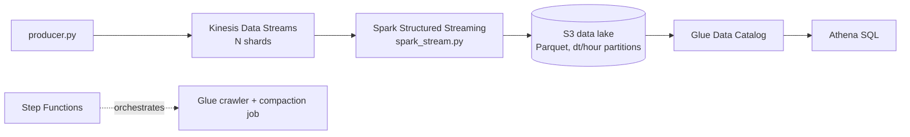

# 06 · Real-Time Clickstream Analytics Pipeline

**Live demo:** https://chidiebereian.github.io/capstone-projects-/#/streaming

**Capacity planning.** Each shard accepts writes of up to 1,000 records/s or 1 MB/s. Producers that exceed that get `ProvisionedThroughputExceededException`; the demo shows this live. High-cardinality partition keys (such as `user_id`) spread load across shards; low-cardinality keys create hot shards.

**Cost control.** Columnar Parquet plus `dt`/`hour` partitions means Athena scans only the columns and partitions a query touches. Athena bills $5 per TB scanned, with a 10 MB minimum per query.

| File | Purpose |
|---|---|
| `src/producer.py` | Batched `put_records` with retry on throttled records |
| `src/spark_stream.py` | Kinesis source, JSON schema, watermark, 10 s tumbling window, Parquet sink |
| `sql/athena.sql` | External table with partition projection plus the demo queries |

**Builds on labs** 18, 32, 33, 34, 35, 36, 37.
