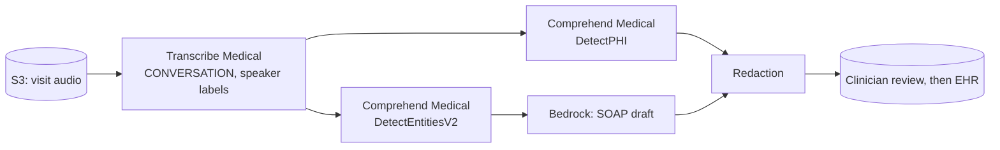

# 07 · Clinical Documentation Copilot

**Live demo:** https://chidiebereian.github.io/capstone-projects-/#/clinical

Turns a recorded doctor-patient visit into a draft SOAP note. PHI is detected and redacted before the note is stored.

`src/pipeline.py` runs the full flow. Every generated note is a **draft for clinician review**; nothing is written to a record without human sign-off.

> All sample data in this repo and demo is fictional. Not for clinical use.

**Builds on labs** 21, 22, 23.
